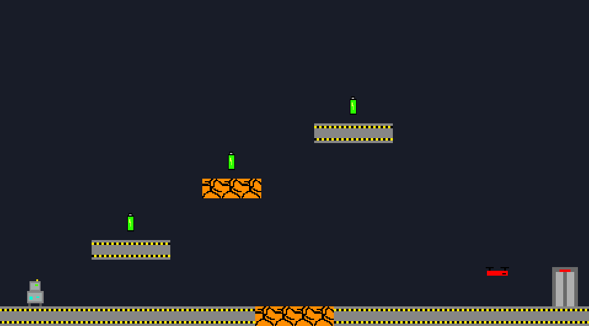
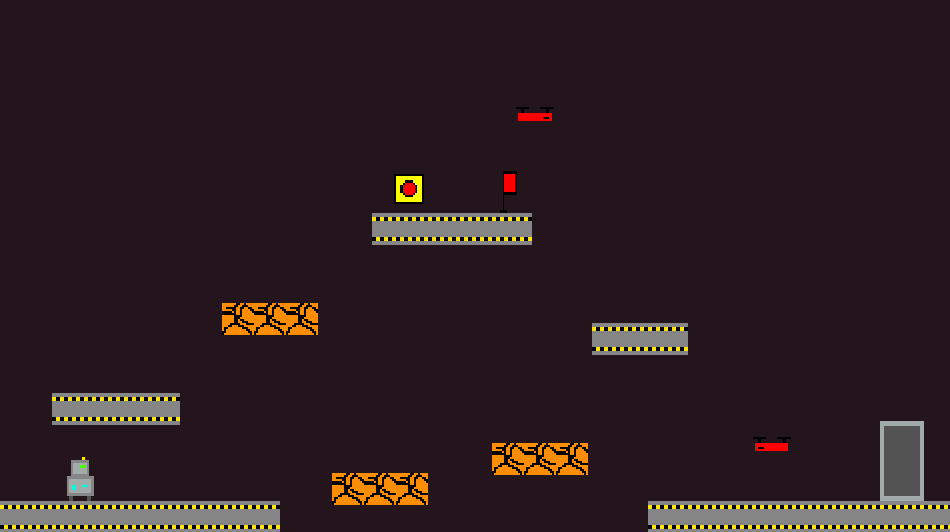

# game-programming-project2

## Power Runner

This game is a simple platformer where you collect batteries avoid enemies and their projectiles and try to make it through the door and to the reactor at the end after collecting the core, there is one checkpoint in the second level and there are breakable platforms so don't stand in one place too long

## Controls
- **A / D** or **Left / Right** - move
- **Space**, **W** or **Up** - jump
- **Esc** - quit

## How the engine works
Every object in the game is a `GameObject`, and its behavior comes from the components attached to it. Objects are built from JSON. `assets/prefabs.json` lists the components for each kind of object, and the level files place those objects and change their values. A factory (`ComponentFactory`) uses a map of component names to functions to create each component and add it to the object.

## Components
| Component | What it does |
|---|---|
| **Body** | Stores position, size, velocity and angle, and handles gravity and collisions with platforms |
| **Sprite** | Draws the object's image, flips it to face the direction it is moving, and tiles it for platforms |
| **Controller** | Reads keyboard input to move and jump the player |
| **Health** | Gives the player 3 lives, respawns them at the checkpoint when hit, and restarts the level when all lives are gone |
| **PatrolChase** | Enemy AI that patrols back and forth and chases the player when they get close |
| **Shooter** | Makes enemies shoot energy balls at the player. The balls are created during gameplay |
| **Projectile** | Removes an energy ball when it hits a wall or after a few seconds |
| **Hazard** | Hurts the player on contact (enemies and energy balls) |
| **Breakable** | Makes a platform shake, break after being stood on too long, and come back later |
| **Pickup** | Batteries and the power core, which are collected when touched |
| **Goal** | The exit door and reactor, which unlock once enough power is collected |
| **Checkpoint** | Sets where the player respawns |